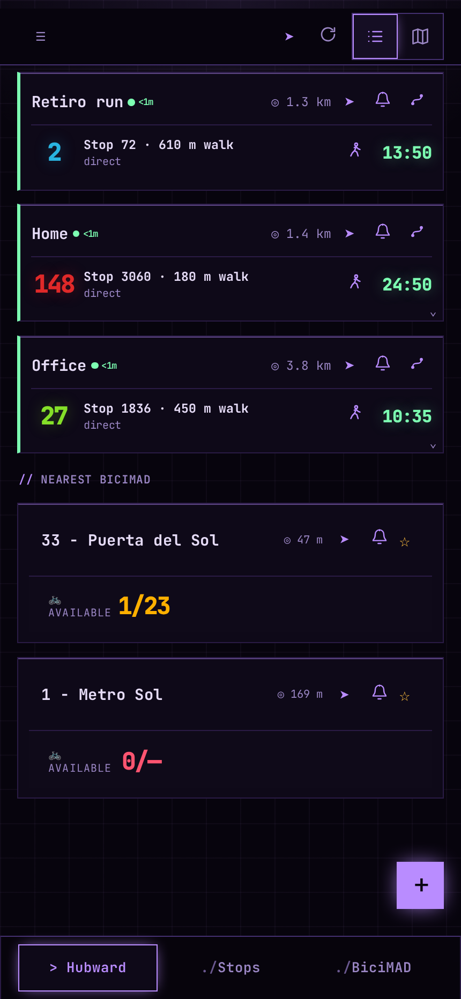
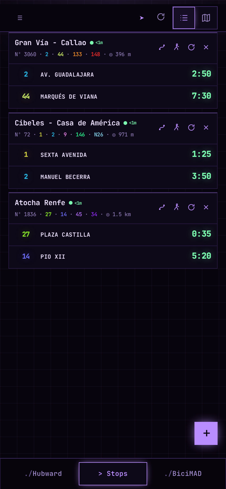
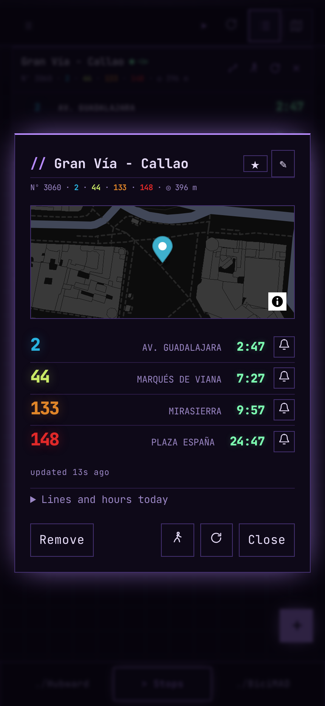
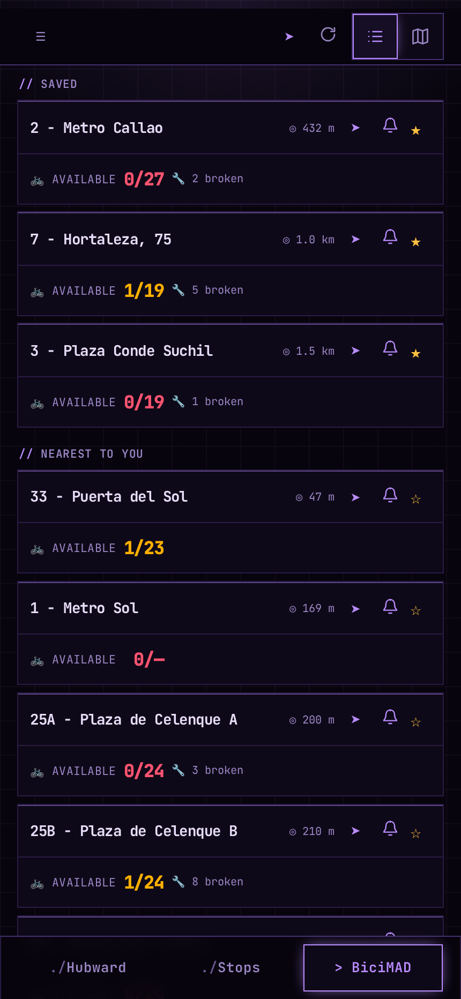
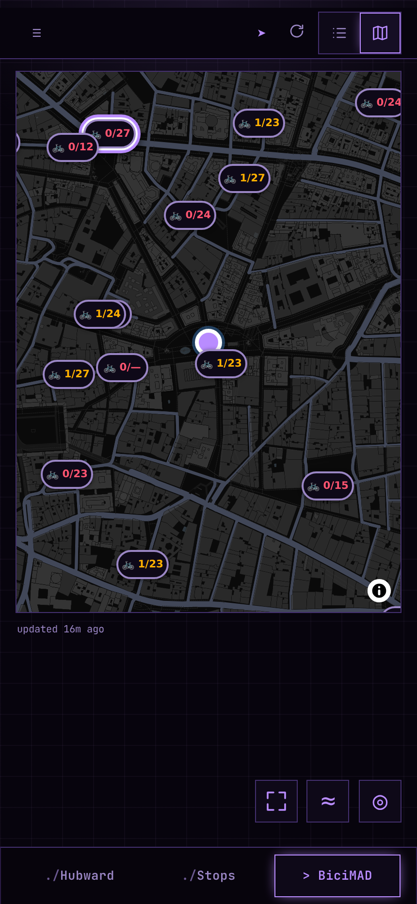
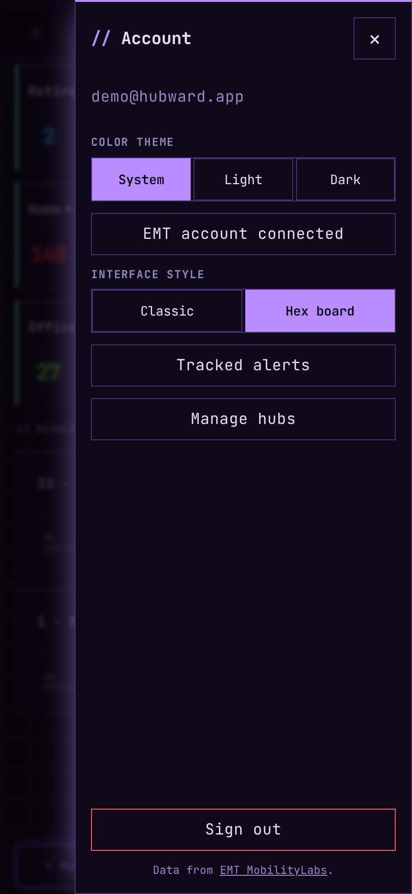
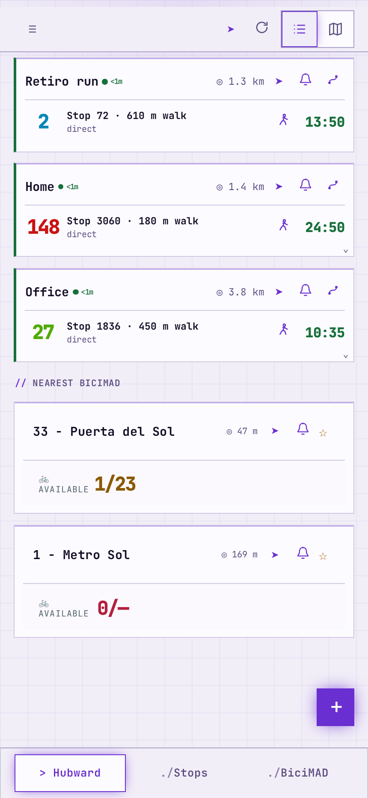
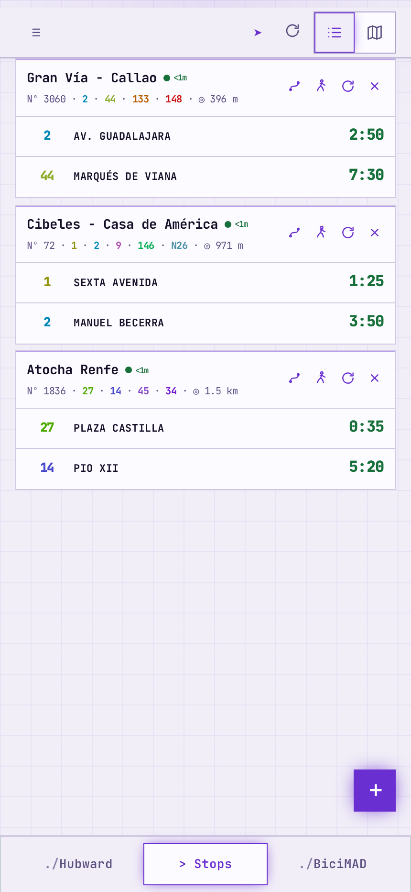
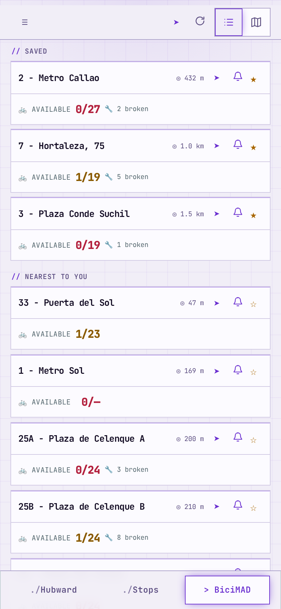
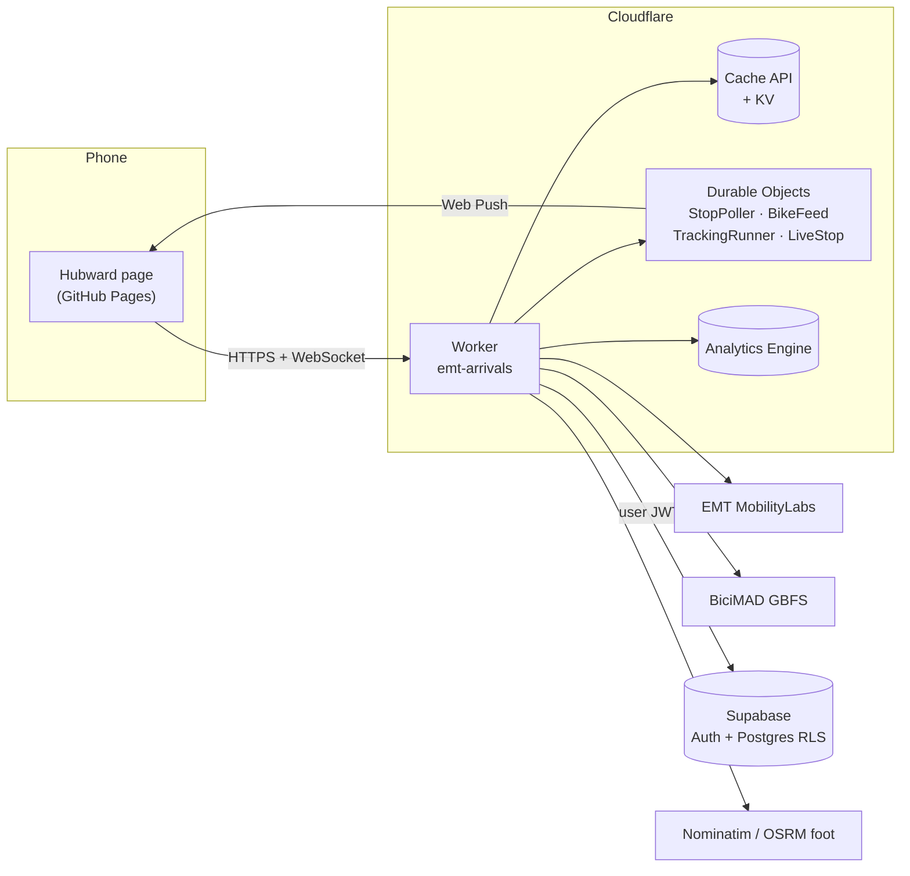

<div align="center">


# Hubward

**Live Madrid buses and BiciMAD bikes, made for the phone in your pocket.**

Real-time EMT arrivals for the stops you use, bike counts for the docks you
care about, and "how do I get to my places from here" answered with live
data. It's a phone-first web app that installs to your home screen.

[**Open the app →**](https://snowu.github.io/hubward/)

</div>

> [!NOTE]
> The project started as an Android home-screen widget in a repo called
> `emt_madrid_widget`, renamed to `hubward` in October 2026. The app was
> called *Hubwise* until September 2026, so internal identifiers still say
> `hubwise`.

---

## Contents

- [What it does](#what-it-does)
- [Screenshots](#screenshots)
- [How it works](#how-it-works)
- [Repository layout](#repository-layout)
- [Running it locally](#running-it-locally)
- [Deploying your own](#deploying-your-own)
- [Configuration reference](#configuration-reference)
- [Background alerts](#background-alerts)
- [EMT usage metrics](#emt-usage-metrics)
- [Testing](#testing)
- [Gotchas worth knowing](#gotchas-worth-knowing)
- [Further reading](#further-reading)
- [Credits](#credits)

## What it does

### 🚌 Buses
- **Saved stops with live countdowns.** Each card shows the next two buses,
  counts down every second, and always says how old its data is.
- **It never shows a blank screen.** On launch you see the last known board,
  labelled with its age, until fresh data arrives.
- **Honest empty boards.** At 4 a.m. a stop says when its first bus runs
  instead of "nothing due", using EMT's own timetable and day-type calendar.
- **Stop sheet.** Tap a card for the full board, a mini map, every line with
  today's service hours, and a name you can edit.
- **Map with nearby stops.** Pan around to find stops. You can check an unsaved
  stop's live times before saving it, to make sure it's the right side of the
  road.
- **Routes and live buses.** Tap a line to draw the direction that stop
  serves, along with every stop on the way. Buses move along the route in real
  time, pushed over WebSockets.

### 🧭 Hubs (journey planning)
- Save the places you actually go, like home, work or the gym, as **hubs**.
- Each hub card picks the best bus there **from where you are now**, using
  live arrivals, real walking distances, and a preference for direct rides
  over transfers.
- Search radii widen automatically at night (00:00–06:00), when only night
  lines run and a longer walk can beat a 40-minute wait.
- One tap gives walking directions to the boarding stop.

### 🚲 BiciMAD
- Rentable bikes, free docks and disabled bikes for nearby and saved
  stations, from the operator's own GBFS feed. MobilityLabs is the fallback.
- Optional owner-only extras: account status, trip history and per-bike
  ratings.

### 🔔 Alerts
- **Track** a bus line at a stop or a bike station and get a push
  notification when a bus is about 15 minutes away or bikes show up. Alerts
  arrive even when the app is closed.

### 🎨 Everything else
- Light, dark or system theme, plus two interface styles: *Hex board*
  (the default, borrowed from hex-lab: violet phosphor, mono, square frames)
  and *Classic*.
- Installable PWA with its own icon, and works on iOS from the Home Screen.
- Sign-in by email magic link. Each user's saved data is isolated by Postgres
  row-level security.

## Screenshots

<table>
  <tr>
    <td align="center"><br><sub>Hubs: the best bus to each place</sub></td>
    <td align="center"><br><sub>Saved stops, live countdowns</sub></td>
    <td align="center"><br><sub>Stop sheet: full board and alerts</sub></td>
  </tr>
  <tr>
    <td align="center"><br><sub>BiciMAD: rentable bikes per station</sub></td>
    <td align="center"><br><sub>BiciMAD map</sub></td>
    <td align="center"><br><sub>Account: theme, style, alerts</sub></td>
  </tr>
  <tr>
    <td align="center"><br><sub>Hubs, light theme</sub></td>
    <td align="center"><br><sub>Stops, light theme</sub></td>
    <td align="center"><br><sub>BiciMAD, light theme</sub></td>
  </tr>
</table>

<sub>Captured from the real page in headless Chromium. The Worker and Supabase
were mocked so it renders signed in, so the stops, hubs and countdowns are demo
data; the BiciMAD counts come from the live public feed.</sub>

## How it works



The design comes down to three rules:

1. **The page holds no secrets.** It's static files on GitHub Pages and only
   ever talks to the Worker. EMT doesn't send CORS headers anyway.
2. **The Worker holds no user data.** It keeps credentials and shared public
   caches. Saved stops, hubs and stations live in Supabase, and the Worker
   forwards the user's JWT so **RLS is the real tenant boundary**.
3. **Upstream calls are shared.** Public payloads (arrivals, stop detail,
   routes, bike counts) sit in the Workers Cache API. Alert polling and the
   live map each fetch one board per stop and fan it out to everyone
   watching, however many people that is.

**Every user brings their own EMT account.** In production
(`EMT_ACCOUNT = "required"`), users connect their own MobilityLabs login after
signing in, so EMT calls made for them use their own quota. The credentials
are stored AES-256-GCM encrypted. Guests still see cached data and bike
counts.

There's **no framework, no bundler and no build step.** `web/` is plain ES
modules, and MapLibre plus the Supabase SDK load from a CDN. Deploying the
page means copying `web/` to Pages.

## Repository layout

```
web/                 the page — static, deployed to GitHub Pages
  index.html         every view and dialog (JS fills them, never templates them)
  app.js             the app, one ES module
  live.js            live-map WebSocket client
  tracking.js        alerts + push subscription UI
  trips.js, cache.js, directions.js, emt-account.js, appearance.js
  sw.js              service worker (notifications only — no offline cache)
api/                 Cloudflare Worker
  src/index.js       routing, CORS, auth, cache policy
  src/emt.js         EMT login, arrivals, stop detail, nearby, routes, timetables
  src/bikes.js       BiciMAD GBFS + MobilityLabs fallback
  src/journey-planner.js   hub planning
  src/pollers.js     shared StopPoller / BikeFeed Durable Objects
  src/tracking.js    per-user TrackingRunner Durable Object
  src/live.js        LiveStop Durable Object (live map)
  src/emt-account.js encrypted per-user EMT credentials
  src/metrics.js     Analytics Engine usage events
  test/              vitest under workerd, recorded EMT fixtures
supabase/            SQL to run once in the Supabase SQL editor
tools/               smoke check, metrics report, push keys, icon generator
design/              static design studies + screenshots
docs/                rollout notes, research, audits, original spec and plan
```

## Running it locally

Requirements: **Node 20+** and a Cloudflare account (for `wrangler`).

```bash
git clone git@github.com:snowu/hubward.git
cd hubward
git config core.hooksPath .githooks   # pre-push smoke check

cd api
npm install
npm test            # page smoke check + Worker test suite, no network needed
```

**The page.** There's nothing to build. Serve the folder and open it:

```bash
python3 -m http.server 4173 --directory web
# → http://localhost:4173
```

By default it talks to the **deployed** Worker. To use a local one, change the
`API` constant near the top of `web/app.js`.

**The Worker:**

```bash
cd api
cp .dev.vars.example .dev.vars   # fill in your own values
npm run dev                      # wrangler dev
```

**Design studies:** serve the repo root and open `design/system-hubs.html`
(see [`design/README.md`](design/README.md)).

## Deploying your own

The URLs are hardcoded in two places: `ALLOWED_ORIGIN` in
[`api/wrangler.toml`](api/wrangler.toml) and `API` in
[`web/app.js`](web/app.js). Point them at each other first.

### 1. Supabase

1. Create a project. Under **Authentication**, enable email magic links and
   sign-ups. Set the Site URL and a Redirect URL to your page's URL (a
   trailing `**` works), and configure custom SMTP.
2. In the SQL editor, run each of these once:

   | file | creates | required? |
   | --- | --- | --- |
   | `supabase/bus_stops.sql` | saved bus stops | yes |
   | `supabase/places.sql` | hubs | yes |
   | `supabase/emt-accounts.sql` | encrypted per-user EMT logins | yes, with `EMT_ACCOUNT = "required"` |
   | `supabase/bike_stations.sql` | favourite BiciMAD stations | optional; the page degrades without it |
   | `supabase/bike_ratings.sql` | per-bike ratings | optional |
   | `supabase/migrate_multi_user.sql` | moves legacy single-user rows to an owner | only when upgrading an old install |

3. Sign in once as yourself and copy your Auth user UUID. That's
   `OWNER_USER_ID`.

### 2. Cloudflare Worker

```bash
cd api
npx wrangler kv namespace create KV     # put the id in wrangler.toml
npx wrangler secret put EMT_EMAIL        # repeat for each secret below
npm run deploy
```

To enable push alerts, generate the VAPID key pair once and keep it. Rotating
it breaks every existing subscription:

```bash
mkdir -p .local
node tools/generate-push-keys.mjs .local/push-secrets.json
cd api && npx wrangler secret bulk ../.local/push-secrets.json && npm run deploy
```

> [!IMPORTANT]
> CI doesn't deploy the Worker. Run `npm run deploy` by hand.

### 3. The page

Pushing to `main` with changes under `web/**` runs
[`.github/workflows/pages.yml`](.github/workflows/pages.yml). That workflow
stamps the commit SHA onto every asset URL, because GitHub Pages caches for
10 minutes and you can't change that. **If you add a new file to `web/`, add
it to the workflow's `sed` pattern**, or phones will keep running the old copy.

## Configuration reference

### Worker vars (`wrangler.toml`, not secret)

| var | values | meaning |
| --- | --- | --- |
| `ALLOWED_ORIGIN` | URL origin | the only origin CORS and WebSockets accept |
| `EMT_ACCOUNT` | `required` / `optional` | whether every user must connect their own EMT account, or can fall back to the shared login |
| `PLANNER_TIER` | `free` / `paid` | sizes hub planning to the Workers plan's subrequest limit (50 vs 10,000) |
| `CLOUDFLARE_ACCOUNT_ID` | id | used by the metrics report |

### Worker secrets (`wrangler secret put`, or `api/.dev.vars` locally)

| secret | needed for |
| --- | --- |
| `EMT_EMAIL`, `EMT_PASSWORD` | shared MobilityLabs login (fallback / background) |
| `SUPABASE_URL`, `SUPABASE_ANON_KEY` | auth + saved data |
| `OWNER_USER_ID` | owner-only features (metrics, BiciMAD account) |
| `EMT_CREDENTIAL_KEY` | per-user EMT accounts. 32 random bytes, base64 |
| `VAPID_PUBLIC_KEY`, `VAPID_PRIVATE_KEY`, `VAPID_SUBJECT` | push alerts |
| `CLOUDFLARE_ANALYTICS_TOKEN` | in-app metrics (**Account Analytics: Read** only) |
| `MPASS_CLIENT_ID`, `MPASS_PASSKEY`, `MPASS_DEVICE_ID` | *optional* owner BiciMAD account badge and trips |
| `MPASS_EMAIL`, `MPASS_PASSWORD` | *optional* override if MPass differs from the EMT login |

> [!CAUTION]
> Never put a secret under `[vars]` in `wrangler.toml`. A var with the same
> name stops you from creating the secret later.

## Background alerts

Open a stop and tap **Track** next to a line, or tap **Track** on a bike
station, then allow notifications. You can manage watches under **Account →
Tracked alerts**. Each user gets up to 20 watches across 5 devices.

| | checked every | notifies when |
| --- | --- | --- |
| 🚌 Bus | 2 minutes | a newly seen bus is **≤ 15 min** away. A vehicle can notify again after 30 min outside the window. |
| 🚲 Bike | 30 seconds | a station that was **empty** goes up to 1–4 bikes. More than 4 silences it until the station empties again. |

- Polling runs in Durable Objects, so alerts arrive with the app closed. One
  `StopPoller` per stop and one city-wide `BikeFeed` serve every user.
- Pushes expire after 2 minutes, so a late alert never arrives.
- A device that hasn't opened the app in **5 days** is paused, and after
  **30 days** it's forgotten. A lost phone stops using quota.
- **iOS / iPadOS:** open the app from its Home Screen icon to enable Web Push.

## EMT usage metrics

The Worker logs every real EMT HTTP call and every cache hit or miss to the
`hubwise_emt_metrics` Analytics Engine dataset. It never logs tokens, emails,
coordinates or response bodies.

```bash
cp .env.metrics.example .env.metrics   # add a read-only Analytics token
npm run metrics                        # last 24h
npm run metrics -- --days 7
```

The owner sees the same report under **Account → Metrics**. **Check it before
changing polling intervals, cache TTLs or journey fan-out.**

## Testing

```bash
cd api
npm test                 # check-web smoke test, then vitest under workerd
npm run check:web        # just the smoke test
node --test ../test/*.test.mjs   # pure web-module tests
npx wrangler deploy --dry-run    # bundle check
```

- **The tests never call EMT.** They use recorded fixtures in
  `api/test/fixtures/`, kept in EMT's original shape.
- **`tools/check-web.mjs`** loads the real `index.html` + `app.js` in jsdom and
  fails if the module throws or an `getElementById` target is missing. This
  catches a page that is syntax-clean but blank on load, which `node --check`
  can't. It also runs from the pre-push hook.
- A *"falling back to 2024-12-30"* compatibility-date warning during tests is
  expected noise.
- CSS and layout still need a real browser. The `design/` fixtures are there
  for that.

## Gotchas worth knowing

The full list lives in [`CLAUDE.md`](CLAUDE.md). These are the ones that bite
first:

- **EMT reports errors inside HTTP 200 responses** through a `code` field.
  Code `80` means either "stop not found" or "token expired", so always log
  in again and retry once before believing it.
- **Code `81` doesn't mean the stop is missing.** Some real stops have no
  detail record. Validate stop IDs against arrivals, never against detail.
- **All coordinates are GeoJSON `[lon, lat]`**, and MapLibre takes them in
  that order, so nothing flips them. If a pin lands in the sea, something did.
- **`estimateArrive` values of `888888` and `999999` are sentinels**, not
  countdowns.
- **Bus positions come from `DistanceBus`, not GPS.** The GPS fix freezes and
  then jumps, while `DistanceBus` counts down smoothly.
- **Line `code` ≠ `label`** (`005` → `5`, `523` → `N23`). Arrivals report
  the label.
- **MobilityLabs bike counts include broken bikes.** GBFS
  `num_bikes_available` is the real rentable number.
- **Bump `CACHE_VERSION`** in `api/src/index.js` whenever a cached payload's
  shape changes.

## Further reading

| doc | what's in it |
| --- | --- |
| [`CLAUDE.md`](CLAUDE.md) | the full engineering notes: API quirks, cache TTLs, page behaviour and the reasons behind it |
| [`docs/emt-account-rollout.md`](docs/emt-account-rollout.md) | per-user EMT accounts: design and rollout |
| [`docs/performance-call-audit.md`](docs/performance-call-audit.md) | where upstream calls go and why |
| [`docs/bicimad-account-api-research.md`](docs/bicimad-account-api-research.md) | read-only research on BiciMAD account APIs |
| [`docs/todo.md`](docs/todo.md) | parked ideas |
| [`docs/superpowers/specs/`](docs/superpowers/specs/) | the original design spec |
| [`design/README.md`](design/README.md) | design studies and UI iteration notes |

**Scope:** EMT city buses and BiciMAD only. Metro, Cercanías and interurban
buses come from CRTM, which uses a separate API and a different stop-ID
namespace, so they're deliberately out of scope for now.

## Credits

- Bus data: [**EMT Madrid MobilityLabs**](https://mobilitylabs.emtmadrid.es)
  ([API docs](https://apidocs.emtmadrid.es)). EMT asks that MobilityLabs be
  credited as the data source.
- Bike data: BiciMAD GBFS feed, published by PBSC.
- Geocoding: [Nominatim](https://nominatim.openstreetmap.org). Walking
  distances: [FOSSGIS OSRM](https://routing.openstreetmap.de). Map data ©
  OpenStreetMap contributors, tiles by CARTO, rendering by MapLibre GL.
- Reference implementations: [`fermartv/EMTMadrid`](https://github.com/fermartv/EMTMadrid)
  and [`fermartv/emt_madrid`](https://github.com/fermartv/emt_madrid).
- The name comes from Discworld, where *hubward* means "towards the Hub".
